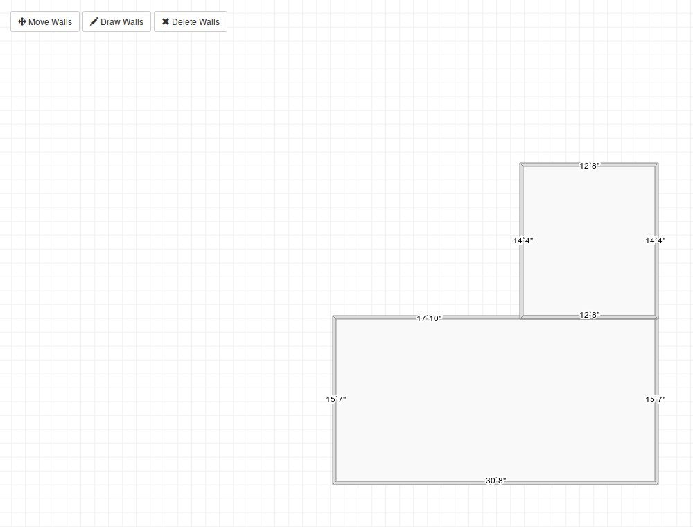
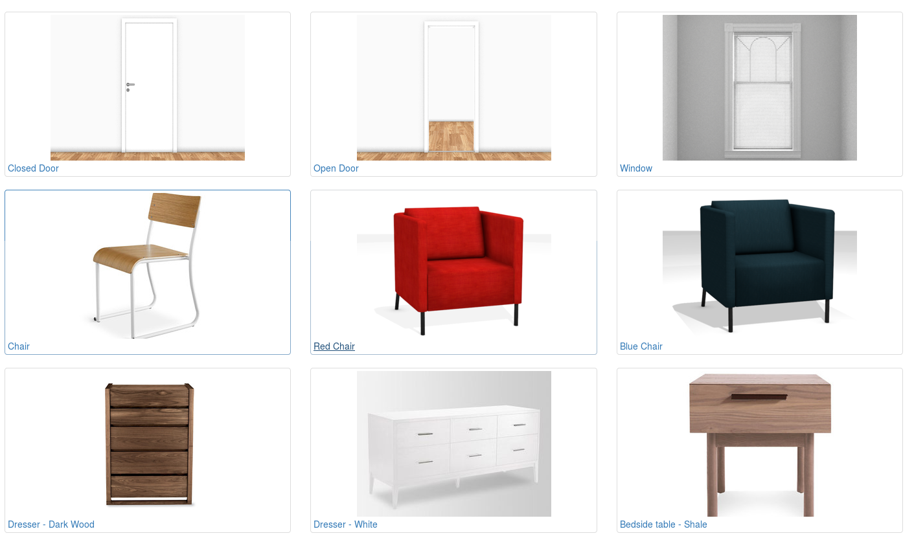
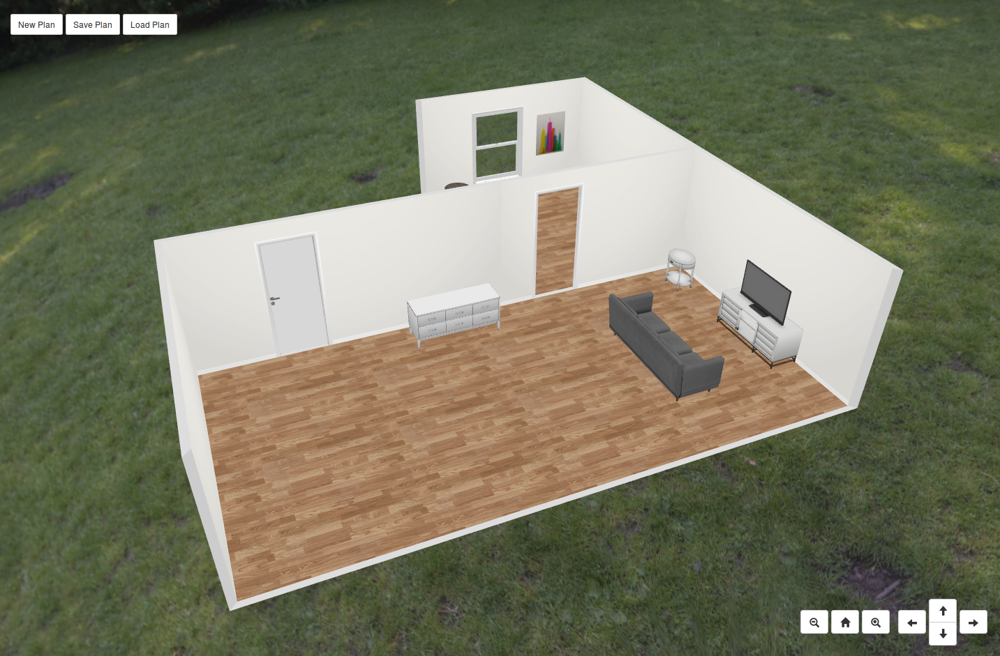

# Demo

[Click for example](https://aalavandhaann.github.io/blueprint-js/demo/)

---

# Introducing Amaippu

  

  <strong><em>Build. Design. Create Architectural Reality.</em></strong>

[Amaippu](https://amaippu.com/) is an AI-powered, web-based architectural design and engineering platform that brings together parametric modelling, 2D/3D floorplan creation, generative AI, real-time visualization, and immersive architectural experiences.

Built around the idea of making architectural design more intelligent, accessible, and computationally driven, Amaippu aims to bridge the gap between conceptual design and digital architectural realization.

The platform brings together a collection of integrated tools designed to streamline architectural workflows, allowing designers, architects, and developers to move from floorplan concepts to detailed, interactive 3D environments.

## The Amaippu Ecosystem

Amaippu comprises several interconnected modules:

- **Chithiram** – An intelligent 2D/3D floorplan editor for creating dimensionally accurate architectural layouts and instantly visualizing them as 3D spaces.
- **Suthiram** – A parametric modelling system for generating and configuring reusable architectural components and structures.
- **Varnam** – An AI-powered material and texture generation system for architectural visualization.
- **Buddhi** – An AI-driven engineering intelligence layer for assisting with architectural and engineering workflows.
- **Avatharam** – A real-time 3D visualization and rendering environment.
- **Bhramam** – An immersive WebVR experience for exploring architectural designs and spaces.

## Our Vision

We envision a future where architectural design is not constrained by disconnected software tools and repetitive modelling workflows.

Amaippu seeks to establish an integrated computational design environment where geometry, engineering intelligence, generative AI, and immersive visualization work together.

Our goal is to make sophisticated architectural design capabilities accessible through the web, while enabling parametric flexibility, reusable digital assets, and intelligent design workflows.

## Explore Amaippu

- **Website:** <https://amaippu.com/>
- **Platform:** <https://amaippu.com/>
- **Contact:** [amaippu@amaippu.com](mailto:amaippu@amaippu.com)

*Amaippu — Building the future of architectural engineering workflows.*

---

# README

This is a JavaScript floorplanner tool based on the existing TypeScript-based project [blueprint3d](https://github.com/furnishup/blueprint3d).

## Current Release: 3.0.1

Many things have changed with this version:

- ~~Now the three.js version used is the latest (1.148.0)~~
- ~~Now the library is a pure MVC framework~~
- ~~The models contain only data~~
- ~~The viewers are respective viewers for the respective dimensions (2D, 3D, 4D? (maybe))~~
- ~~Overall improvement towards performance~~
- ~~No more canvas for viewer2d, now using PixiJS~~
- ~~No more Rollup, now using the Parcel bundler~~
- Refer to previous branches for older working versions

### What is missing?

- ~~The 3D items are missing ATM (WIP, coming soon)~~
- ~~A major overhaul is in store for viewer3d and 3D items, stay tuned~~
- ~~Implementation of an application-like interface to make the demo more complete (WIP, TODO)~~

## Acknowledgements

My sincere thanks to the following libraries and their contributors:

- [**three.js** – Superheroes from the 3rd dimension](https://www.threejs.com/)
- [**PixiJS** – Superheroes from the 2nd dimension](https://www.pixijs.com/)
- [**pixi-viewport** – Hero who saved the 2D day](https://github.com/davidfig/pixi-viewport)
- [**thi.ng/geom-hull** – Geometry hero from 'n' dimension](https://github.com/thi-ng/umbrella)
- [**bezier-js** – This one curves (like Mr. Fantastic)](https://pomax.github.io/bezierjs/)
- [**GSAP** – Tweening superheroes](https://greensock.com/gsap/)
- [**QuickSettings** – Superhero to mechanize the project](https://github.com/bit101/quicksettings)
- [**Archimesh** – Superhero of parametric dimensions](https://github.com/dfelinto/blender-1/tree/master/archimesh)

And of course to [**Parcel**](https://parceljs.org/) and [**npm**](https://www.npmjs.com/) for their ever awesomeness, and to the tons of other libraries that make this project possible.

## Texture Packs and Credits

Base source location: [3dtextures.me](https://3dtextures.me/)

### Floor Textures

- [Stylized Stone Floor 001](https://3dtextures.me/2020/07/16/stylized-stone-floor-001/)
- [Terracotta Tiles Floor 003](https://3dtextures.me/2019/05/29/terracotta-tiles-003/)
- [Rubber Floor 001](https://3dtextures.me/2019/07/02/rubber-floor-001/)
- [Marble Tiles 001](https://3dtextures.me/2019/10/07/marble-tiles-001/)
- [Stone Tiles 004](https://3dtextures.me/2020/02/17/stone-tiles-004/)
- [Wood Herringbone Tiles 001](https://3dtextures.me/2020/08/05/wood-herringbone-tiles-001/)
- [Terrazzo Tiles 001](https://3dtextures.me/2019/07/19/terrazzo-tiles-001/)

### Wall Textures

- [Terracotta Bricks 002](https://3dtextures.me/2020/07/09/terracotta-bricks-002/)
- [Stone Wall 015](https://3dtextures.me/2020/06/26/stone-wall-015/)
- [Stylized Sci-fi Wall 001](https://3dtextures.me/2020/06/09/stylized-sci-fi-wall-001/)
- [Concrete Wall 005](https://3dtextures.me/2020/03/30/concrete-wall-005/)
- [Concrete 016](https://3dtextures.me/2019/12/12/concrete-016/)
- [Stone Wall 012](https://3dtextures.me/2019/11/20/stone-wall-012/)
- [Concrete Wall 002](https://3dtextures.me/2019/10/16/concrete-wall-002/)
- [Concrete Column 001](https://3dtextures.me/2019/07/15/concrete-column-001/)
- [Brick Wall 017](https://3dtextures.me/2019/11/21/brick-wall-017/)

## Docs

Yes, the initiative has begun for the documentation. Of late I have been getting inquiries on using this framework, so it is time to have the documentation rolling.

- [Docs](https://aalavandhaann.github.io/blueprint-js/docs)
- [Wiki](https://github.com/aalavandhaann/blueprint-js/wiki) – basic integration tips and information

## Demo: VR

The ability to export the floorplan as GLTF gives the scope of having easy VR with A-Frame. Export the layout to use it directly with A-Frame, or process it further using Blender and then use it with A-Frame.

- [Click for example of VR – 1](https://aalavandhaann.github.io/blueprint-js/build/vrtest)
- [VR – 2](https://aalavandhaann.github.io/blueprint-js/build/vrtest/minimal.html)

> **Note:** You will notice a lot of flickering in VR mode. This is because of the overlapping materials in the floorplan.

## What is this?

This is a customizable application built on three.js that allows users to design an interior space such as a home or apartment. Below are screenshots from our example app (link above).

1. **Create a 2D floorplan**

   

2. **Add items**

   

3. **Design in 3D**

   

## Developing and Running Locally

### Scripts and their purpose

- `npm run-script app-dev`: Generates the application and serves the app folder with unminified code.
- `npm run-script app-production`: Generates the application and serves the app folder with minified code.
- `npm run-script frameworkonly-dev`: Builds and generates only `bp3djs.js` (unminified) that can be used in your project with custom design. Ensure you know how to use the framework and its API. The generated framework can be found inside the `bin` folder.
- `npm run-script app-dev`: Builds and generates only `bp3djs.js` (minified) that can be used in your project with custom design. Ensure you know how to use the framework and its API. The generated framework can be found inside the `bin` folder.

Then, visit `http://localhost:1234` (most probably) in your browser.

## Contribute!

This project and the [original project](https://github.com/furnishup/blueprint3d) require a lot more work. If you are a *yodha* of TypeScript, kindly visit the original project; the author is a wonderful human being who facilitated this idea, these efforts, and materials in the first place. Otherwise, if you are someone like me who likes to play around with ES6, you can use this one.

Please contact us if you are interested in contributing.

### Todos and hurrays on completed ones

- More complete documentation of classes (this is necessary and a must-do for others to contribute)
- Make it easier to build a complete application using blueprint3d (cleaner API, more inclusive base, easier integration with a backend)
- Better serialization format for saving/loading "designs"
- jQuery is not used at all; instead I used the EventDispatcher from three.js (hurray)
- Better use of npm conventions and packaging
- Various bug fixes (hurray for items that are stuck and don't move)
- Refactor `three/*`
- Update to current three.js (hurray)
- Introduce a more formal persistency format
- Put all relevant settings into `Core.Configuration` to make them read-/writeable, User settings?
- Complete type docs for all entities
- There are a few `TODO_Ekki`s left, kill them all (let me know, Yodha)

## Directory Structure

### `src/` directory

The `src` directory contains the core of the project. Its sub-directories:

| Directory     | Description                                                          |
| ------------- | -------------------------------------------------------------------- |
| `core`        | Basic utilities such as logging and generic functions                |
| `floorplanner`| 2D view/controller for editing the floorplan                         |
| `items`       | Various types of items that can go in rooms                          |
| `model`       | Data model representing both the 2D floorplan and all items in it    |
| `three`       | 3D view/controller for viewing and modifying item placement          |

## Notes about changes from the original

- Adding routines to modify the skybox images as environment (a crude implementation)
- Otherwise the API is ditto and the same
- Adding a `BoxHelper` to show selected states of items

---

## Support me

